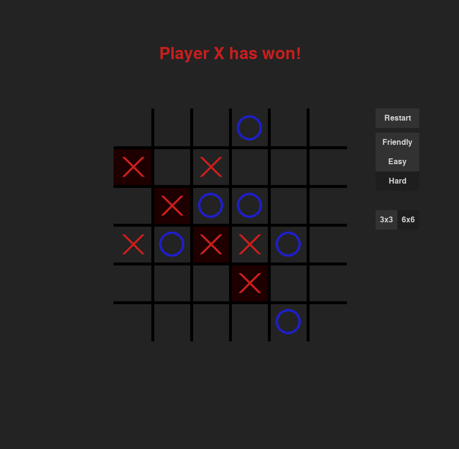

# Tic Tac Toe (3x3 and 6x6)

A TTT game made in python using Pygame. Includes a minimax AI.  

## How to run
```bash
python3 main.py
```   

## UI

## Game modes
Friendly mode : local two-player mode.    
Easy mode : AI plays random moves.  
Hard mode : AI uses minimax search with alpha beta pruning.     

Hard button can be pressed during gameplay to request the AI to play the next move, or watch AI vs AI play.